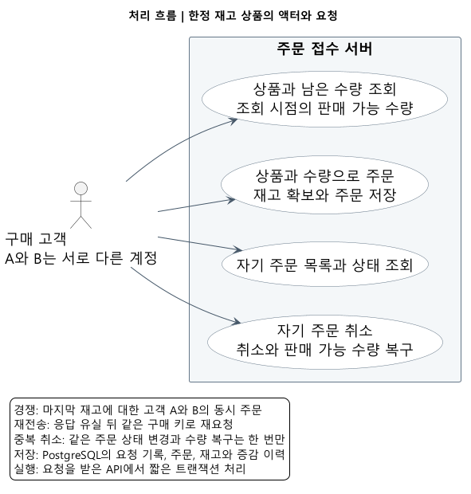

# 한정 재고 상품 주문 접수 서버 | Spring Boot 백엔드 세미 프로젝트

한정 판매 상품의 주문을 접수하고 재고를 관리하는 Spring Boot 백엔드 프로젝트입니다. 주문 접수 시 주문 수량만큼 재고를 확보하고, 고객이 취소하면 취소한 수량을 다시 재고에 돌려놓습니다. 여러 고객이 마지막 상품을 동시에 주문하거나 같은 구매를 다시 요청해도 재고가 중복으로 차감되지 않도록 처리합니다.



## 주요 기능

- 상품과 남은 수량 조회, 주문 접수, 자기 주문 목록과 상태 조회, 주문 취소.
- 같은 구매의 재전송은 원래 주문 반환. 다른 구매는 남은 재고 안에서 접수.
- 주문, 재고 차감과 증감 이력을 함께 저장하고, 취소도 상태와 재고를 함께 복구.
- 인증 계정별 주문 접근, CSRF 검사, 입력과 요청 크기 제한, 쓰기 요청 한도.

## 마지막 재고 처리

고객 A와 B가 남은 상품 1개를 각각 주문하면 한 주문만 수락합니다. PostgreSQL에서 `남은 수량 >= 주문 수량`일 때만 차감하는 UPDATE를 실행하고, 실제 차감에 성공한 요청이 주문을 만듭니다.

같은 구매의 재요청은 고객 ID와 `Idempotency-Key`의 유일성 제약으로 구별합니다. 취소는 접수 상태를 바꾼 요청만 수량을 돌려줍니다. 주문과 취소는 각각 트랜잭션 하나로 저장합니다.

자세한 동시 주문 처리 방식은 [구현 설명](docs/IMPLEMENTATION.md)을 확인해주세요.

## 실행 방법

Windows, Java 21, PowerShell 7, Node.js와 PostgreSQL 16 실행 파일이 필요합니다. 빌드는 Gradle Wrapper 8.14.3, 서버는 Spring Boot 3.5.16과 Spring JDBC를 사용합니다.

프로젝트 폴더를 PowerShell 7에서 열고 실행합니다.

```powershell
# 처음 준비할 때 PostgreSQL의 bin, lib, share가 있는 폴더 지정
# .tools/pgsql에 준비돼 있으면 이 설정 생략
# $env:STOCK_PG_SOURCE = 'C:\Program Files\PostgreSQL\16'

# 전용 DB에서 전체 검사 후 실행 파일 생성
.\scripts\test.ps1 -IsolatedDatabase

# 서버 시작, 주문과 취소 예제, 종료
.\scripts\start-demo.ps1 -Port 18086
.\scripts\demo-request.ps1
.\scripts\stop-demo.ps1 -StopDatabase
```

`start-demo.ps1`은 로컬 백그라운드 서버를 시작합니다. 주소는 기본 `http://127.0.0.1:18086`이며 사용 중이면 다른 포트를 지정합니다. 예제 스크립트는 주문, 같은 키의 재전송과 두 번의 취소를 실행한 뒤 재고가 원래 수량인지 보여줍니다.

프로젝트 전용 DB를 별도로 생성합니다. 계정 비밀번호와 실행 정보는 `.runtime`에 자동 생성되며 Git에 포함되지 않습니다. 검사 DB는 실행마다 새로 만들고 종료합니다. 데모의 주문과 DB 데이터는 종료 후에도 보존됩니다.

## API

| 경로 | 역할 |
| --- | --- |
| `GET /csrf` | 주문과 취소 요청에 사용할 CSRF 토큰 조회 |
| `GET /products`, `GET /products/{id}` | 상품 목록과 남은 재고 조회 |
| `POST /orders` | 주문 접수 |
| `GET /orders`, `GET /orders/{id}` | 내 주문 목록과 주문 상태 조회 |
| `POST /orders/{id}/cancel` | 내 주문 취소와 재고 복구 |

자세한 요청 형식과 응답은 [API 명세](docs/API.md)를 확인해주세요.
