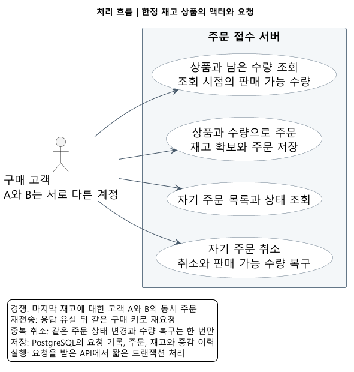

# 한정 재고 상품 주문 접수 서버 | Spring Boot 백엔드 세미 프로젝트

한정 재고 상품의 주문과 취소를 처리하는 Spring Boot 백엔드 프로젝트입니다. 고객이 주문하면 주문 수량만큼 재고를 차감하고, 자기 주문을 취소하면 그 수량을 다시 더합니다.

여러 고객이 마지막 재고를 동시에 주문하거나, 응답을 받지 못해 같은 구매를 다시 요청하는 상황을 다룹니다.

## 주요 기능

- 상품 목록과 남은 재고 조회
- 주문 접수와 내 주문 목록, 상태 조회
- 내 주문 취소와 주문 수량만큼 재고 복구
- 같은 구매의 재요청과 중복 취소 처리
- 로그인 계정별 주문 접근, 입력 검증과 쓰기 요청 제한



## 주문과 취소 처리

| 상황 | 처리 방식 |
| --- | --- |
| 마지막 재고에 주문이 겹침 | 조건부 UPDATE로 수량 확인과 차감을 한 번에 실행. 차감에 성공한 요청만 주문 생성 |
| 같은 구매를 다시 요청 | 고객 ID와 구매 키의 유일성 제약으로 중복 등록을 막고 기존 결과 반환 |
| 같은 주문의 취소가 겹침 | 접수 상태를 취소 상태로 바꾼 요청만 재고 복구 |

같은 구매를 다시 요청할 때는 구매 키인 `Idempotency-Key`를 유지합니다. 같은 키에 상품이나 수량이 다르면 거절하며, 별도 구매에는 새 키를 사용합니다.

주문, 재고와 증감 이력은 한 트랜잭션으로 저장합니다. 취소 상태와 재고 복구, 복구 이력도 함께 저장해 중간에 오류가 나면 모두 되돌립니다.

서버 프로그램별로 고객의 구매와 취소 횟수를 따로 계산하고, 두 작업의 동시 쓰기 수는 함께 제한합니다.

## 사용 기술

Java 21, Spring Boot 3.5.16, Spring JDBC, Spring Security, PostgreSQL 16, Flyway를 사용합니다. Spring JDBC의 `JdbcClient`로 조건부 갱신과 변경 건수를 직접 확인하고, 서비스의 `@Transactional`로 함께 저장할 데이터를 묶습니다.

## API

| 경로 | 역할 |
| --- | --- |
| `GET /csrf` | 주문과 취소 요청에 사용할 CSRF 토큰 조회 |
| `GET /products`, `GET /products/{id}` | 상품 목록과 남은 재고 조회 |
| `POST /orders` | 주문 접수 |
| `GET /orders`, `GET /orders/{id}` | 내 주문 목록과 주문 상태 조회 |
| `POST /orders/{id}/cancel` | 내 주문 취소와 재고 복구 |

모든 API는 인증된 계정으로 호출합니다. 주문과 취소에는 `GET /csrf`로 받은 세션 쿠키와 토큰 헤더가 필요합니다. 토큰을 URL이나 폼 본문에 넣어 헤더를 대신할 수 없습니다.

자세한 요청 형식과 응답, 오류 코드는 [API 명세](docs/API.md)를 확인해 주세요.

## 실행 방법

Windows, Java 21, PowerShell 7, Node.js와 PostgreSQL 16 실행 파일이 필요합니다. 빌드는 저장소의 Gradle Wrapper 8.14.3을 사용합니다.

프로젝트 폴더를 PowerShell 7에서 열고 실행합니다.

```powershell
# PostgreSQL의 bin, lib, share가 있는 폴더 지정
# .tools/pgsql에 준비돼 있으면 생략
# $env:STOCK_PG_SOURCE = 'C:\Program Files\PostgreSQL\16'

# 전용 DB에서 전체 검사 후 실행 파일 생성
.\scripts\test.ps1 -IsolatedDatabase

# 서버 시작
.\scripts\start-demo.ps1 -IsolatedDatabase -Port 18086

# 주문, 재요청, 취소와 재취소 시연
.\scripts\demo-request.ps1

# 이 프로젝트의 시연 서버와 DB 종료
.\scripts\stop-demo.ps1 -StopDatabase
```

서버는 백그라운드로 실행되며 기본 주소는 `http://127.0.0.1:18086`입니다. 포트가 사용 중이면 `-Port`에 다른 값을 지정합니다. `-IsolatedDatabase`는 기존 DB 대신 새 DB를 만듭니다. 다음 실행에서 같은 데모 데이터를 쓰려면 이 옵션을 생략합니다.

시연은 각 단계의 요청과 응답, 재고를 출력하고 HTML 보고서로 저장합니다. 같은 구매의 주문 ID가 달라지거나 재취소로 재고가 늘면 검사에 실패합니다. 비밀번호, 쿠키와 CSRF 토큰 값은 보고서에 넣지 않습니다.

전체 검사와 시연을 마치면 다음 파일이 생성됩니다.

| 파일 | 내용 |
| --- | --- |
| `build/libs/limited-stock-order-api-0.1.0.jar` | 전체 검사 후 생성한 서버 실행 파일 |
| `build/reports/tests/test/index.html` | 전체 JUnit 검사 보고서 |
| `build/reports/demo/index.html` | 시연의 요청, 응답과 단계별 재고 |

시연은 순서대로 보낸 HTTP 요청을 비교합니다. 동시 주문, DB 이력 대조와 장애 처리는 JUnit 보고서에서 별도로 확인합니다. 위 파일들은 로컬에서 생성하며 GitHub에는 포함하지 않습니다.

예제 고객과 상품은 `start-demo.ps1`이 선택하는 `demo` 프로필에서만 생성합니다. 계정 비밀번호와 실행 정보는 `.runtime`에 저장하고 Git에서 제외합니다. 검사 DB는 실행 후 종료하며, 데모 데이터는 종료 후에도 보존됩니다. DB를 다른 실행에서도 쓰고 있다면 `-StopDatabase` 없이 서버만 종료합니다.

## 문서

- [구현 설명](docs/IMPLEMENTATION.md): 요청 처리 흐름, 저장 SQL과 기술 선택 이유
- [HTML 코드 해설](docs/code-explorer/index.html): 폴더별 원본 코드, 줄별 설명과 어노테이션. 로컬 파일을 브라우저에서 열어 사용
- [요청 제한과 재요청 검사](docs/REVIEW_FOLLOWUP.md): 횟수 계산, CSRF 헤더 정책과 롤백 후 재요청 처리
- [검증 기록](docs/VERIFICATION.md): 실제 실행 결과와 미검증 범위
