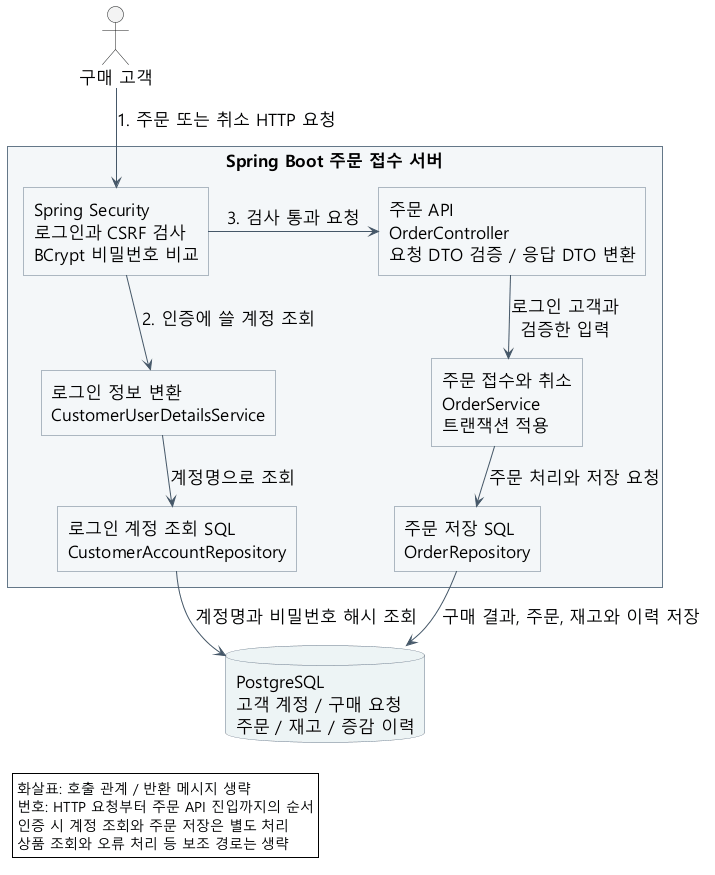

# 한정 재고 상품의 주문 접수와 취소 처리

한정 판매 상품의 주문을 접수하고 재고를 관리하는 Spring Boot 백엔드 프로젝트입니다. 고객이 상품과 수량을 선택해 주문하면 그 수량만큼 재고를 확보합니다. 고객이 자기 주문을 취소하면 저장된 주문 수량을 다시 재고에 돌려놓습니다.

마지막 상품을 여러 고객이 동시에 주문하는 상황과, 응답을 받지 못한 고객이 같은 주문이나 취소를 다시 요청하는 상황을 다룹니다. 동시성 제어와 저장 실패 처리를 직접 구현하고 검사하기 위한 세미 프로젝트입니다.

## 요청 처리와 코드 구성



Spring MVC로 HTTP 요청을 받고, `@RestController`에서 HTML 화면 대신 JSON을 반환합니다. 코드의 역할은 다음과 같이 나눴습니다.

- Controller는 로그인한 고객과 입력값을 확인하고 서비스를 호출합니다. 반환된 주문 정보를 응답 DTO로 바꿉니다.
- Service는 주문 접수와 취소의 순서를 정하고, 함께 저장할 데이터를 트랜잭션으로 묶습니다.
- Repository는 SQL을 실행합니다. 상품 조회와 주문 저장은 각각의 저장소가 맡습니다.

주문 JSON은 요청 DTO로 받고, 내부에서는 `Order` 같은 주문 정보를 사용합니다. 서비스와 저장소에 HTTP DTO를 전달하지 않아, 외부 JSON 필드 변경이 내부 자료형 변경으로 바로 이어지지 않게 했습니다. 입력 두 값을 넘기는 데 별도 명령 객체나 매핑 라이브러리는 추가하지 않았습니다.

인증 방식 설정과 계정 조회 SQL도 분리했습니다. `CustomerAccountRepository`는 계정을 조회하고, `CustomerUserDetailsService`는 결과를 Spring Security의 로그인 정보로 바꿉니다. 비밀번호 비교는 Spring Security와 BCrypt가 맡습니다. 보안 설정을 읽을 때 계정 SQL까지 함께 다루지 않도록 나눈 구성입니다.

## 같은 구매의 재전송: 멱등키와 유일성 제약

서버에 주문이 저장돼도 응답이 끊기면 고객은 주문 성공 여부를 알 수 없습니다. 이때 새 주문을 만들지 않도록, 클라이언트는 같은 구매의 재요청에 같은 `Idempotency-Key`를 보냅니다. 서버는 로그인 고객과 이 키의 조합으로 구매를 구별합니다.

기존 기록이 없으면 구매 요청을 등록합니다. `(buyer_id, request_key)` 유일성 제약이 있어 같은 구매가 겹쳐도 한 요청만 새 기록을 만들 수 있습니다. 등록 SQL은 `ON CONFLICT DO NOTHING RETURNING id`를 사용합니다.

다른 요청이 같은 키를 등록 중이면 DB에서 그 요청의 종료를 기다립니다. 앞선 요청이 커밋하면 새 등록을 생략하고, 롤백하면 이번 요청이 등록합니다. 처음 조회에서는 없었어도 등록 대기 중 결과가 확정될 수 있으므로, 등록하지 못한 요청은 새 SELECT로 결과를 읽습니다.

같은 구매 키에 저장된 상품과 수량이 요청값과 같으면 원래 주문의 현재 상태를 반환합니다. 다르면 거절합니다. 이미 취소된 주문도 새로 접수하지 않습니다. 처음 저장한 재고 부족 결과 역시 유지하므로, 별도 구매에는 새 키를 사용합니다.

## 마지막 재고 처리: 조건부 UPDATE

재고 조회에서 1개가 남았다고 확인한 고객 두 명이 각각 1개를 주문할 수 있습니다. 조회한 수량으로 각자 계산하면 두 주문이 같은 재고를 차지할 수 있어, DB에서 수량 확인과 차감을 한 SQL로 실행합니다.

```sql
UPDATE inventories
SET available_quantity = available_quantity - :quantity
WHERE product_id = :id AND available_quantity >= :quantity;
```

새 구매 요청을 등록한 뒤 이 UPDATE가 재고를 차감한 경우에만 주문을 만듭니다. 같은 상품을 바꾸는 요청은 PostgreSQL에서 기다리고, 앞선 요청이 끝나면 바뀐 수량으로 조건을 다시 검사합니다. 재고가 1개면 한 주문만 접수됩니다. 요청이 도착한 순서까지 보장하는 대기열은 아닙니다.

Spring JDBC의 `JdbcClient`를 사용한 이유는 수량 조건과 변경 건수를 SQL로 직접 확인하기 위해서입니다. `SELECT FOR UPDATE` 후 검사하거나 JPA의 버전 충돌을 처리하는 방법도 있지만, 이 처리는 조건부 UPDATE로 표현할 수 있습니다. 같은 상품에 요청이 몰리면 잠금 대기는 남으며, 방식별 성능 우위는 측정하지 않았습니다.

## 주문과 취소의 트랜잭션

주문 접수는 구매 요청 등록, 재고 차감, 주문과 차감 이력, 요청 결과를 한 트랜잭션으로 저장합니다. 저장 도중 SQL이 실패하면 함께 롤백합니다. `@Transactional`은 부분 저장을 막고, 유일성 제약과 조건부 UPDATE는 각각 중복 구매와 재고 경쟁을 막습니다.

재고가 부족하면 주문은 만들지 않고 재고 부족 결과를 저장합니다. 서비스에서 바로 예외를 던지면 이 결과도 롤백되므로, 커밋을 마친 뒤 컨트롤러가 재고 부족 응답으로 바꿉니다. 결과가 빠진 구매 요청은 커밋 시점의 DB 제약 트리거로도 거절합니다.

취소는 로그인 고객의 주문이 접수 상태일 때만 취소 상태로 바꿉니다. 상태를 실제로 바꾼 요청만 원래 주문 수량을 복구하고 복구 이력을 저장합니다. 취소 응답을 잃어 다시 요청하거나 여러 취소가 겹쳐도, 이미 취소된 주문에는 수량을 더하지 않습니다. 취소 상태, 재고와 복구 이력도 함께 저장합니다.

로컬 DB 중단 검사에서는 커밋 오류가 추가 롤백 오류에 가려지는 문제를 확인했습니다. `DataSourceTransactionManager`를 명시해 원래 SQL 오류를 보존하고, 연결 장애를 일시 오류로 구분하도록 고쳤습니다. 커밋 도중 연결이 끊기면 저장 여부를 모를 수 있으므로 성공이나 롤백으로 단정하지 않습니다. DB 연결이 회복된 뒤 클라이언트가 같은 구매 키로 결과를 확인하며, 취소는 같은 주문 ID를 사용합니다. 서버가 구매를 자동 재실행하지는 않습니다.

## 입력과 주문 접근 검사

상품 ID와 수량은 요청 DTO의 필수값과 양수 조건으로 검사합니다. 소수 수량, 문자열 숫자, 알 수 없거나 중복된 JSON 필드는 변환 단계에서 거절합니다. 직접 호출된 서비스도 ID와 수량을 검사하며, 남은 재고는 입력 어노테이션이 아닌 DB의 UPDATE 조건으로 판단합니다.

구매자는 로그인 계정에서 결정하고, 주문 조회와 취소 SQL에도 고객 ID 조건을 넣습니다. 고객이 보낸 다른 사람의 ID나 임의의 복구 수량은 사용하지 않습니다. 주문과 취소에는 CSRF를 검사하고 본문은 8KiB로 제한합니다.

구매와 취소의 고객별 요청 횟수는 따로 계산합니다. 구매 재시도가 많아도 취소 한도까지 소진하지 않게 한 선택입니다. 서버 프로그램 하나의 동시 쓰기 한도는 두 작업이 함께 사용합니다.

잘못된 로그인 정보는 인증 실패(401), 일시적 DB 연결 장애는 일시 처리 불가(503), 그 밖의 인증 서비스 오류는 서버 내부 오류(500)로 구분합니다. 계정 조회 결과를 문자열로 출력해도 비밀번호 해시를 노출하지 않습니다.

## 코드 구성을 유지하는 자동 검사

패키지를 나눠도 컨트롤러가 저장소를 바로 호출하거나 서비스에 HTTP DTO가 들어오면 역할이 다시 섞입니다. 기존 검사는 정해 둔 클래스의 선언만 확인해, 새 클래스나 메서드 안에서만 쓰는 타입을 놓칠 수 있었습니다.

`PackageStructureTest`에 ArchUnit을 적용해 제품 패키지의 컴파일된 클래스를 자동으로 읽습니다. 컨트롤러의 저장소 직접 사용, 서비스의 SQL 실행, 내부 코드의 HTTP DTO 사용 등을 검사합니다. 일부러 규칙을 어긴 예제 두 개도 검사해 거절하는지 확인했습니다. ArchUnit과 이 예제들은 테스트에만 쓰며 실행 JAR에는 포함하지 않습니다.

이 검사는 지정한 패키지의 의존 규칙을 확인합니다. 주문 수량이나 커밋 결과의 정확성은 실제 HTTP와 DB 검사로 따로 확인합니다.

## 검증 결과

최신 코드의 정규 JUnit 검사는 172건입니다. 실제 HTTP/DB 83건, 별도 JVM 종료와 재시작 1건, 단위/구조 검사 88건이 모두 통과했습니다. 구조 검사 9건은 이 172건에 포함됩니다. DB 서버 자체를 중단했다가 복구하는 5조건은 각각 세 번, 별도 15건으로 검사했습니다.

| 재현 조건 | 관찰 결과 |
| --- | --- |
| 마지막 재고 1개에 서로 다른 고객의 주문 | 주문 1건 접수, 다른 요청은 재고 부족, 남은 수량 0 |
| 같은 구매 키로 20건 동시 요청 | 주문과 차감 이력 각각 1건, 나머지는 같은 주문 반환 |
| 같은 주문의 취소 20건 | 수량 복구와 복구 이력은 각각 한 번 |
| 주문 또는 취소 저장 중 SQL 오류 | 미확정 변경 전체 롤백, 기존 수량과 상태 유지 |
| 커밋 후 응답 유실 또는 JVM 종료 | 같은 키/주문 ID로 결과 확인, 추가 차감이나 복구 없음 |
| 서버 JVM을 유지한 채 DB 중단과 재시작 | 연결 회복 후 재요청 성공, 주문과 재고 및 이력 일치 |

재고는 초기 수량에서 취소되지 않은 주문 수량 합계를 뺀 값과 대조했습니다. 실제 DB에서는 서버 JVM 두 개의 중복 구매와 재고 차감, 취소도 검사했습니다. 앱 화면은 없으며 HTTP 클라이언트로 요청했습니다. 호스트 전원 차단, 여러 서버가 공유하는 요청 한도와 운영 수용량은 미검증입니다. 이전 코드의 k6와 SQL 실행 계획은 최신 코드의 성능 측정으로 사용하지 않습니다.

구매 키는 자동 삭제하지 않습니다. 보존 기간과 저장량 한도는 정하지 않았습니다. 외부 공개 운영에는 TLS와 인증 시도 자체의 요청 제한이 별도로 필요합니다.

## 코드와 세부 설명

- [주문 서비스](../src/main/java/dev/mentoring/orders/service/OrderService.java), [주문 SQL](../src/main/java/dev/mentoring/orders/repository/OrderRepository.java): 구매 재요청, 수량 조건과 저장 순서.
- [코드 해설](CODE_GUIDE.md): 메서드와 어노테이션을 순서대로 읽는 설명.
- [입력 검증과 코드 구성](VALIDATION_AND_STRUCTURE.md): DTO, 인증 조회 분리와 구조 검사 규칙.
- [검증 기록](VERIFICATION.md): 재현 조건, 실행 수와 원시 결과.
- [상세 처리 그림](design/README.md): 마지막 재고, 재전송과 취소의 분기.

표현과 동작을 대조한 공식 문서: [Spring MVC의 응답 반환](https://docs.spring.io/spring-framework/reference/6.2/web/webmvc/mvc-controller/ann-methods/return-types.html), [Spring 트랜잭션 적용](https://docs.spring.io/spring-framework/reference/6.2/data-access/transaction/declarative/annotations.html), [PostgreSQL의 동시 UPDATE](https://www.postgresql.org/docs/16/transaction-iso.html#XACT-READ-COMMITTED), [ArchUnit 의존 관계 검사](https://www.archunit.org/userguide/html/000_Index.html).
