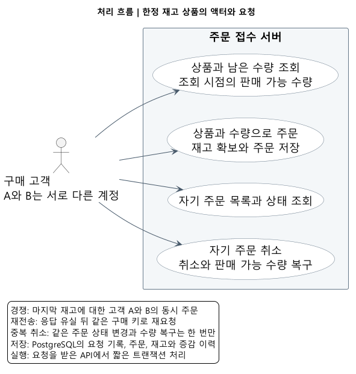
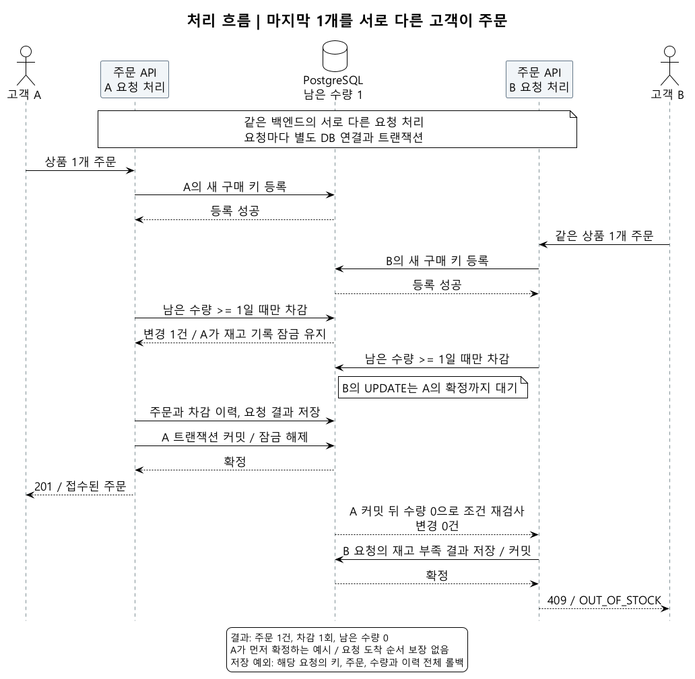
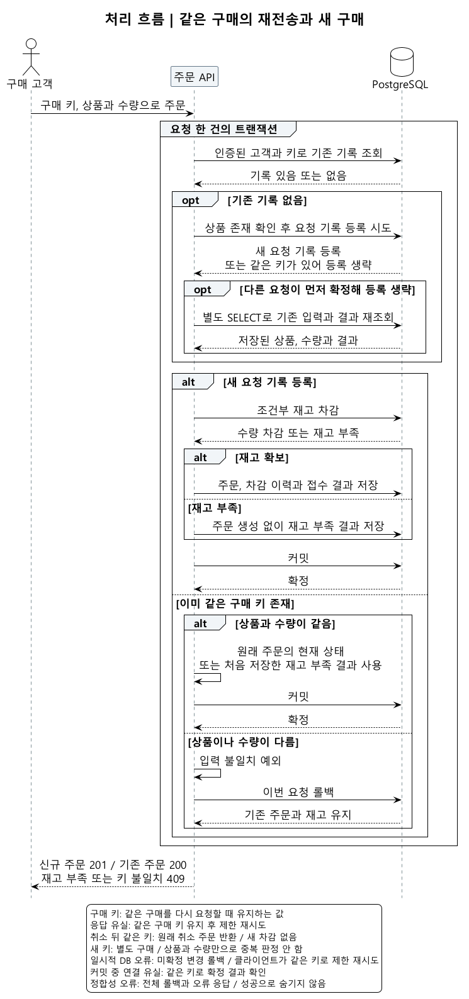
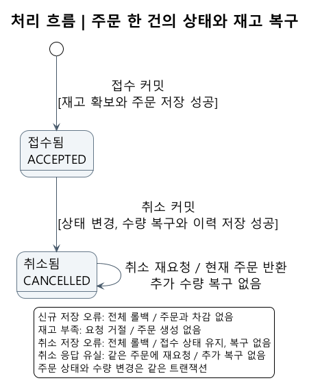

# 한정 재고 상품의 주문 접수 서버

주문 처리의 설계와 흐름입니다. 실제 실행 결과는 [검증 기록](../VERIFICATION.md)에 정리합니다.

## 사용자와 기능

한정 판매 상품을 구매하려는 고객이 남은 수량을 확인하고 주문하는 백엔드입니다. 서버가 주문을 수락하면 그 수량만큼 재고를 확보하고, 고객이 주문을 취소하면 다시 판매할 수량으로 돌려놓습니다. 다른 고객도 같은 상품을 주문할 수 있으므로 마지막 재고를 두고 경쟁합니다.

고객은 상품 한 종류와 수량을 지정해 주문하고, 자기 주문을 조회하거나 취소합니다. 상품과 초기 재고는 시험 데이터로 준비하며 API로 요청합니다.

재고는 주문을 저장할 때 확보합니다. 조회 이후 다른 고객이 먼저 주문하면 재고가 부족할 수 있습니다.

## 요청 중첩과 처리 규칙

| 상황 | 서로 다른 요청인지 | 지킬 규칙 |
| --- | --- | --- |
| 고객 A와 B가 마지막 상품을 각각 주문 | 서로 다른 구매 | 재고가 1개면 한 주문만 수락 |
| 주문 응답을 못 받은 고객 A가 다시 전송 | 같은 구매의 재전송 | 같은 주문 반환, 추가 차감 없음 |
| 같은 주문의 취소 요청이 겹침 | 같은 주문의 취소 | 취소와 재고 복구는 한 번만 |
| 고객 A의 취소 중 고객 B가 새 주문 | 서로 다른 작업 | 취소와 주문의 확정 결과에 맞는 재고 유지 |

서로 다른 고객이 같은 상품을 주문하면 재고 경쟁이 생깁니다. 서버가 주문을 수락한 뒤 응답만 끊긴 경우의 재전송도 대비합니다.

## 마지막 재고 처리

서버는 `남은 수량 >= 주문 수량`인 경우에만 차감하는 조건부 UPDATE를 사용합니다. 같은 상품의 차감이 겹치면 PostgreSQL에서 기다린 뒤 조건을 다시 확인합니다. 차감한 요청만 주문을 만들고 함께 커밋합니다.

## 주문 재전송 처리

클라이언트는 한 번의 구매에 요청 키를 만들고, 응답을 못 받아 다시 보낼 때도 같은 키를 사용합니다. 서버는 인증된 고객과 요청 키의 조합으로 앞선 결과를 찾습니다. 상품이나 수량이 다르면 거절합니다. 같은 상품을 별도로 더 사려는 행동은 새 키를 쓰는 새 주문입니다.

## 주문 취소와 재고 복구

서버는 접수된 주문만 취소 상태로 바꿉니다. 상태를 바꾼 요청만 재고를 복구하며, 취소 상태와 복구 이력도 함께 커밋합니다. 중간 저장이 실패하면 모두 되돌려 주문은 접수 상태로 남습니다. 이미 취소된 주문에는 다시 수량을 더하지 않습니다.

## 처리 방식

- Spring Boot와 PostgreSQL의 짧은 트랜잭션으로 주문과 재고를 함께 저장합니다.
- Spring JDBC의 `JdbcClient`로 조건부 UPDATE와 변경 건수를 직접 확인합니다.
- 재전송은 DB 유일성 제약, 재고 경쟁은 조건부 UPDATE, 중복 취소는 상태 조건으로 각각 막습니다.

접수한 주문의 수량은 고객이 취소할 때까지 확보한 상태로 유지합니다.

## 상세 설계

- [처리 규칙과 API 명세](RULES_AND_API_SPEC.md): 요청 키, 오류 응답, 저장 대상과 재시도 규칙.
- [기술 선택과 비용](TECHNICAL_DECISIONS.md): 잠금 방식 비교, 함께 저장할 데이터와 선택 이유.
- [구현과 검증 계획](IMPLEMENTATION_PLAN.md): 구현 순서, 실제 DB에서 확인할 조건과 측정 범위.
- 그림 원문: [액터](diagrams/01-actors.puml), [재고 경쟁](diagrams/02-last-stock.puml), [재전송](diagrams/03-request-retry.puml), [취소와 상태](diagrams/04-cancellation-state.puml).
